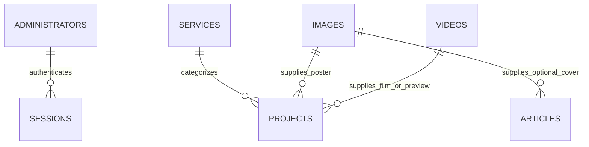
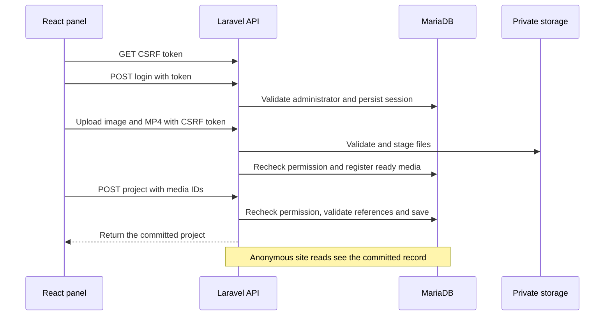
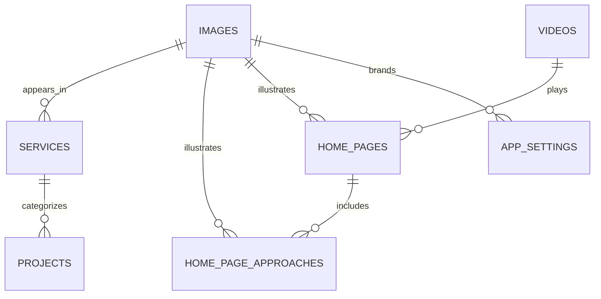
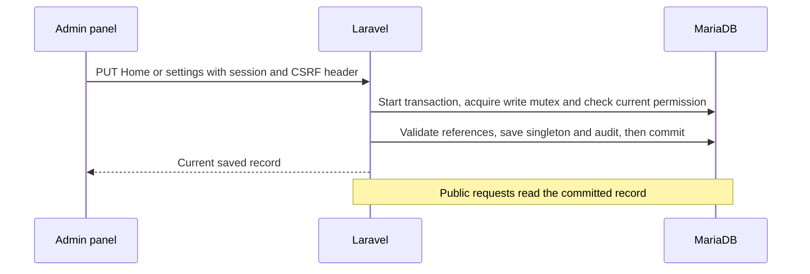

# Bear Studio Web design

This Laravel application renders the public Blade website and provides the HTTP API consumed by the independent React management application. The panel source, components, build and SPA route handling belong to the panel project. Laravel exposes administrative API routes only on the configured admin host and public routes on the website host. Both hosts may read committed media.

On DirectAdmin the public website and admin API entry points load the same private Laravel backend. The admin origin serves the independently built React files and forwards `/api/v1/` to its PHP entry point; other frontend navigation falls back to the panel index.html. The session cookie is host-only and administrative mutations require the explicit CSRF header.

## Scope

The Laravel application owns public website rendering and the API used by the existing React panel. The panel covers projects, services, Home, FAQs, articles and categories, settings, users and roles. The public website reads committed content from MariaDB. `docs/openapi.json` records the endpoint and hosting contracts. Existing files and editorial records are preserved during MariaDB schema upgrades. A fresh installation has an empty editorial catalog and can be provisioned locally before deployment.

## Data and consistency

Store sessions and media outside `public`. Use MariaDB with InnoDB and READ COMMITTED isolation. Application writes acquire the shared write-mutex row inside their transaction to preserve cross-catalog authorization and ordering invariants. The request checks current permission, validates reference rows, and writes the project in one transaction. Project references restrict deletion. An upload writes staged files outside the transaction and then publishes metadata and files together under a short reservation. An unowned file after abrupt termination stays private and can be reconciled by an operator. Public readers resolve only committed metadata. Asset filenames derive from server-issued IDs.

Migration `0001_01_01_000003_add_project_order` initializes internal positions from the former public order by creation time and slug. New projects append, and edits preserve their position. The admin project table saves the full list of canonical slugs via `PUT /api/v1/admin/projects/sort`. The API checks the current write permission, CSRF token and exact catalog membership before saving the order in one transaction. An invalid or stale list returns 400. The management list, public project catalog, Home's featured selection and next-project navigation all follow the saved order.

## Users and roles

Authentication uses a Secure, HttpOnly host-only Laravel session cookie, server-side storage, CSRF header validation on administrative mutations, a 15-minute idle limit and an 8-hour absolute limit. User and role writes also require signing in within the previous fifteen minutes. A fresh database uses the private `admin:create` command to provision its first administrator.

Administrators sign in with an immutable canonical mobile. The panel can create an active account without assigning roles, edit the name and active state, assign up to twenty roles, and set a managed password. Passwords use 12–128 characters with an uppercase Latin letter, lowercase Latin letter, digit and nonalphanumeric character. Users receive the union of permissions from their current roles. Role names are display labels and the permission keys come from a closed catalog.

Each access mutation checks fresh permissions and grant scope inside one MariaDB transaction. Role permission changes also check the current permission union of each member. A mutation cannot remove the actor's own access or leave the system without an active user holding `users.read`, `users.write`, `roles.read` and `roles.write`. Roles with any member cannot be deleted. Role ordering saves the whole catalog without changing permissions. Password, membership, active-state and assigned-role permission changes invalidate affected sessions. Audit metadata records identifiers and the type of change in the same transaction.

Migration `0001_01_01_000004_create_access_roles` preserves existing accounts and initializes the role catalog. A single active legacy operator with the standard pilot grants receives the full administrator role. Other legacy accounts retain their prior grants through equivalent roles. Use the private CLI to provision an access manager where the migrated database lacks one. Existing pilot passwords remain usable. To write access changes after upgrading, sign in again for a current ticket.

## Articles and categories

The public archive and the administrator's article list both show the complete catalog without filter controls or paging controls. The panel collects 24-item API pages under `GET /api/v1/admin/articles`, which accepts only the `page` query parameter. Article forms still require a category. Article and category reads check `articles.read`. Their mutations check fresh `articles.write` and CSRF in one transaction and save bounded audit data.

New articles use a ready article-context image for the cover. The server sanitizes HTML before saving it, and the resulting text must contain visible content. Category slug changes update article references atomically, and references prevent deleting a category. Category ordering saves the entire category catalog.

Migration `0001_01_01_000005_add_article_management` preserves existing article slugs and gives each legacy article a stable UUID and the Uncategorized category. Legacy plaintext stays escaped, and a legacy record without a cover keeps that state until an editor supplies one.

The public articles API supports the ASP query shape, including 24-item pages and optional title/category criteria. It returns articles with ready covers. The Blade archive shows the complete eligible catalog and preserves existing coverless detail pages.

## Service, Home, FAQ and settings editing

Services and FAQs are complete ordered catalogs. Save a complete catalog order in one administrative transaction. Project references protect services in use, and media references protect ready images and videos in use. The Home editor replaces its singleton and its four ordered Approach entries together. Settings store one record with brand and contact fields, palette colors, upload profiles and nullable logo references. Settings reads also provide the upload dimensions and limits. The public site and public read endpoints reflect committed changes immediately.

## Media maintenance and discovery

Media inventories use the 24-item API page size. Deletion of referenced media returns a conflict. Accepted deletions and interrupted uploads create bounded cleanup work. The authenticated cleanup operation retries pending work and keeps ready files available until an operator selects them for deletion. Public media URLs and thumbnails remain stable.

The public host serves `/robots.txt` and `/sitemap.xml`. The sitemap includes the top-level public pages and current project and article routes. It uses `APP_URL` as the canonical origin. Indexing defaults to enabled in production and can be overridden with `APP_ALLOW_INDEXING`. The admin host blocks crawler discovery.

